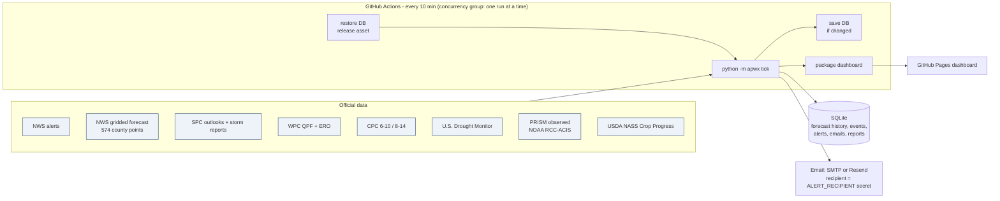

# Architecture

## Overview

## The tick

`python -m apwx tick` is the only scheduled entry point. Each run:

1. **Official alerts** (always): `api.weather.gov/alerts/active?area=<12 states>`; alerts touching monitored counties are classified (crop exposure aware) and de-duplicated by VTEC event; new CRITICAL/HIGH items are queued for immediate email.
2. **Forecast cycle** (when >= 2 h 45 min since the last one, or before a report if data is older than 4 h): auxiliary refreshes (NASS every 6 h, Drought Monitor and PRISM every 12 h), NWS gridpoints for 574 counties (3 parallel workers, retries with exponential backoff, a failed county reuses its previous forecast if under 6.5 h old and is flagged *stale*), SPC/WPC/CPC polygons intersected with county points, station observations, assessment, event reconciliation and change detection.
3. **Immediate email**: all queued items in one message.
4. **Daily / weekly reports** when their Central-time slot has passed and they have not been sent for the day/week (catch-up after outages).
5. **Retries** for emails that failed earlier (up to 6 attempts), **maintenance** (retention pruning, VACUUM) once a day, **dashboard build** when anything changed or hourly.
6. Writes `persist`, `dashboard` and `keepalive` flags for the workflow (`$GITHUB_OUTPUT`).

Every step runs in isolation: an outage of one source is recorded in `source_status` and shown on the dashboard and in reports, while the remaining steps continue.

## Persistence

- **SQLite** single file (`journal_mode=DELETE`). Tables: `cycles`, `county_snapshots` (full per-county snapshot, kept 30 h for comparisons), `county_history` (compact metrics per cycle, 35 days, used for the forecast-change charts), `latest_hourly`, `nws_alerts`, `alert_tracks`, `events`, `event_history`, `notifications` (with de-duplication keys), `reports`, `content_ideas`, `crop_progress`, `drought`, `observed`, `station_obs`, `storm_reports`, `source_status`, `runs`, `meta`.
- Between cloud runs the file is gzipped and uploaded as a **versioned GitHub Release asset** (`state-db` release, newest 5 kept; restore verifies `PRAGMA integrity_check` and falls back to an older snapshot). This avoids repository growth and needs no external database account.
- The workflow's concurrency group serializes runs, so two runs never write the state at the same time.

## Email

SMTP (any provider) or the Resend API, chosen by `EMAIL_PROVIDER`. The recipient is read only from the `ALERT_RECIPIENT` secret and never written to code, logs or the database. Messages are multipart (plain text + branded HTML with an inline logo). Each notification has a unique de-duplication key; delivery failures are retried on later runs. Without credentials (or with `APWX_DRY_RUN=1`) emails are written to `outbox/` and marked `dry-run`.

## Dashboard

Static HTML/CSS/JS (`site/`) reading JSON produced by `apwx/dashboard/build.py`; d3 v7.9.0 and topojson-client 3.1.0 from CDNs and the us-atlas 3.0.1 county geometry. Deployed by `actions/deploy-pages` only when the data changed. Views: overview (KPIs, risk map, top developments, state cards), interactive county map with 12 layers (risk, lows, highs, rain, observed rain, snow, gusts, drought, SPC, ERO, CPC temperature/precipitation) and filters (crop, state, hazard, search), county panel (current forecast hour + station observation, 72 h hourly chart, 7-day table, outlooks, drought, crop stage, forecast history), crop risk matrix with explanations, regional comparison, forecast-change history, alerts and email log, report archive, content ideas, data-source health and scheduler runs. Times are shown in U.S. Central Time.

## Time zones

Internal timestamps are UTC. Reports, schedules and the dashboard use America/Chicago (with a built-in U.S. DST rule when the IANA database is unavailable). NWS intervals (`validTime` + ISO-8601 duration) are parsed exactly; 6-hour accumulations are prorated to report windows.

## Security and privacy

Secrets live only in GitHub Actions secrets. In a public repository the run logs and the `state-db` release assets are publicly readable, so the recipient is never logged or stored and email error messages are scrubbed of addresses and credentials (`notify/email.py: scrub`). The NWS User-Agent is generic unless the optional `NWS_USER_AGENT` variable is set. The dashboard on GitHub Pages is **publicly reachable by URL** (it contains weather analysis, report archives and content ideas, never addresses or secrets); for a private dashboard see SETUP.md (Cloudflare Access option).

## Hosting options evaluated

| Option | Verdict |
|---|---|
| **GitHub Actions + Pages + release-asset state (chosen)** | One account, no cost on a public repo, Python standard library only (testable on this laptop without installs), built-in secrets, logs and run history. Scheduled runs can start several minutes late and occasionally be skipped at peak load; the catch-up design absorbs this. The job is a low-burden scheduled pipeline that builds and publishes this repository's dashboard, which keeps it within GitHub's Actions usage terms; intervals below 5 minutes are not possible and are not used. |
| Google Cloud Run Jobs + Cloud Scheduler | More punctual (1-minute schedules) and private dashboards possible; needs a billing account, container build and gcloud tooling. Good upgrade path - the same code runs unchanged. |
| AWS Lambda + EventBridge + S3/SES | Similar to Cloud Run; SES sandbox fits a single verified recipient. More setup. |
| Render cron jobs + Postgres | Simple PaaS, but paid (cron + database) and still needs a Git host. |
| Cloudflare Workers + D1 | Minute-level crons and cheap, but JavaScript/Python-on-Pyodide rewrite and no local Node.js to test. |

**Alert latency.** NWS offers no push API for the public alert feed, so alerts are polled. With a 10-minute schedule and GitHub's queueing, typical detection-to-email latency is about 10-20 minutes. Faster options: an external scheduler that triggers `workflow_dispatch` every 5 minutes, or running `python -m apwx tick` every 2 minutes on Cloud Run / a small VM.